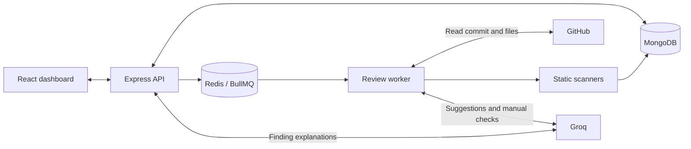

# LaunchGuard

**An on-demand security and code-quality review for your GitHub project, with plain-English findings, suggested fixes, and manual checks tailored to what your app should do.**

[Open the live app](https://launchguard-6wyf.onrender.com/)

Connect a repository, describe what you’re building, and choose a full review or a review of the latest changes. Each report is tied to a Git commit, so you can see which version was checked, where a problem was reported, and what changed since your last completed review.

## Features

- **Review an entire project or its latest changes.** A full review scans eligible files at a specific commit. A latest-changes review checks changed files, their direct local dependencies and callers, and relevant package files. If the impact cannot be mapped reliably, LaunchGuard falls back to a full review and labels it in the report.
- **See what needs attention first.** Findings are ordered by severity. Repeated occurrences of the same problem and fix are grouped together, with affected files and line numbers listed in one place.
- **Understand a finding.** Expand an explanation for the problem, its impact, and steps to address it. You can also copy a fix prompt for your coding agent. Dependency findings include the affected package and an upgrade version when the advisory supplies one.
- **Get coding suggestions beyond security findings.** Request a separate review of eligible frontend and backend source for issues such as repeated logic, unclear names, and unnecessary nesting. Each suggestion points back to the code.
- **Generate manual checks for your application.** LaunchGuard uses the project description and eligible source to suggest scenarios, steps, and expected results. Try each scenario in your app and mark it as checked. Progress is saved.
- **Follow a project over time.** Expand a project in review history to revisit reports by commit. Latest-changes reports distinguish new, existing, and resolved findings and retain earlier findings where a scanner could not complete its check.

## How to use it

1. Open the live app and select **Connect GitHub**. Install the GitHub App on the repositories you want to review.
2. Select **Add project**, choose a repository, and describe who uses the app and what should happen. For a study platform, for example, “Only invited participants can enter a private room” gives the manual checks a concrete behavior to cover.
3. Select **Review Entire Project** to establish a baseline. After pushing changes to the default branch, use **Review Latest Changes** to compare against the last completed review.
4. Open **Security findings** and select a finding to see the affected locations. Expand its explanation or request a fix prompt.
5. Open **Coding suggestions** or **Manual checks** to generate those separately. Large reviews run in batches and save progress so you can continue after a provider limit or interruption.

## Tech stack

| Area | Technologies | Role |
| --- | --- | --- |
| Frontend | React, Vite, Tailwind CSS | Project dashboard, report views, and review controls |
| Backend | Node.js, Express | GitHub sign-in, project and review APIs, and production frontend serving |
| GitHub integration | GitHub App, Octokit | Authorized repository access, commit comparisons, and source retrieval |
| Persistence | MongoDB, Mongoose | Projects, reviews, findings, explanations, and manual-check progress |
| Background processing | Redis, BullMQ | Queue review jobs, retry failed attempts, and resume AI batches |
| AI guidance | Groq API | Generate explanations, coding suggestions, and manual checks on request |
| Packaging and hosting | Docker, Render | Run the frontend, API, worker, and scanner tools in one service |

## How it works

The API records a review in MongoDB and queues a job in Redis. The worker checks repository access, retrieves files at the requested commit, and runs the applicable scanners in sequence. It saves each scanner’s outcome alongside the findings, so users can distinguish an empty result from an incomplete scan.



| Scanner | What it checks |
| --- | --- |
| Gitleaks | Possible exposed credentials in selected text files |
| OSV-Scanner | Known dependency advisories from npm, Yarn, and pnpm lockfiles |
| Semgrep | Source patterns covered by the bundled JavaScript rules and their supported TypeScript targets |
| ESLint | JavaScript quality issues and selected React/JSX patterns |

A review can complete with findings. A scanner with no applicable files can be skipped without failing the review. A partial report means some checks or selected source coverage were incomplete. The report’s findings are leads to investigate, and manual checks are instructions for the user to perform.

## Run locally

### Prerequisites

- A GitHub App with read-only **Contents** access, installed on a test repository. Register `http://localhost:3000/api/github/callback` as a callback URL.
- MongoDB Atlas or a MongoDB replica set that supports transactions, and a reachable Redis instance with a TCP or TLS connection URL.
- A Groq API key to use the AI features.
- Docker with Linux containers, or Node.js 24 and npm for development.

```sh
git clone https://github.com/Kanakchauhan9822/LaunchGuard.git
cd LaunchGuard
```

Copy [Backend/.env.example](Backend/.env.example) to `Backend/.env` and fill in your own values. Keep an existing configured file if you already have one. Generate two independent secret values by running this command twice, once for `JWT_SECRET` and once for `TOKEN_ENCRYPTION_KEY`.

```sh
node -e "console.log(require('node:crypto').randomBytes(32).toString('hex'))"
```

### Option 1 · Docker

Set `FRONTEND_URL=http://localhost:3000` and `PORT=3000` in your local environment file. Use MongoDB and Redis addresses reachable from inside the container. With Docker Desktop, a service running on the host can be addressed through `host.docker.internal`.

```sh
docker build --platform linux/amd64 -t launchguard .
docker run --rm --name launchguard --env-file Backend/.env -p 3000:3000 launchguard
```

Open **http://localhost:3000**. The root [Dockerfile](Dockerfile) builds the frontend and includes the scanner tools. The image uses the Linux AMD64 build of OSV-Scanner.

### Option 2 · Development with Vite

Set `FRONTEND_URL=http://localhost:5173`, keep the backend on port `3000`, and use development cookie settings. Install Gitleaks, OSV-Scanner, and Semgrep for local scans. ESLint and its React plugin are backend npm dependencies.

```sh
npm --prefix Backend ci
npm --prefix Frontend ci
```

Start the backend and frontend in separate terminals.

```sh
npm --prefix Backend run dev
```

```sh
npm --prefix Frontend run dev
```

Open **http://localhost:5173**. Vite forwards API requests to the backend.

## Environment variables

| Variable | Value or purpose |
| --- | --- |
| `MONGO_URI` | Connection string for the application database |
| `REDIS_URL` | Redis connection string beginning with `redis://` or `rediss://` |
| `GITHUB_APP_ID`, `GITHUB_APP_SLUG` | ID and URL slug of your own registered GitHub App |
| `GITHUB_CLIENT_ID`, `GITHUB_CLIENT_SECRET` | OAuth credentials from that same GitHub App |
| `GITHUB_REDIRECT_URI` | Registered callback URL ending in `/api/github/callback` |
| `FRONTEND_URL` | Browser-facing origin, including scheme and port when running locally |
| `JWT_SECRET` | Session signing secret of at least 32 characters |
| `TOKEN_ENCRYPTION_KEY` | 32 random bytes encoded as 64 hexadecimal characters |
| `GROQ_API_KEY`, `GROQ_MODEL` | Provider key and optional model override for AI requests |
| `PORT`, `NODE_ENV` | Listening port and runtime environment. Use `production` on the HTTPS deployment. |
| `GITLEAKS_PATH`, `OSV_SCANNER_PATH`, `SEMGREP_PATH` | Optional scanner executable paths. Set these to your installed binaries when the defaults differ. |

## Checks

Run the frontend checks from the repository root after installing dependencies.

```sh
npm --prefix Frontend run lint
npm --prefix Frontend run build
```

With the API running, open **http://localhost:3000/api/health** and look for `{"status":"ok"}`. This checks the HTTP server. To verify the full workflow, review a small repository you control, inspect the scanner outcomes in its saved report, and request a manual check separately to verify the AI connection.

## Deployment

The live app runs as a Docker web service on Render. To host your own copy, select the repository-root Dockerfile, use `.` as the build context, configure the environment variables above in the service, and set the health-check path to `/api/health`. MongoDB and Redis run outside the container.

Set `FRONTEND_URL` to your public HTTPS origin and `GITHUB_REDIRECT_URI` to that same origin followed by `/api/github/callback`. Register that exact callback in the GitHub App settings before testing sign-in.

## Security and review scope

- LaunchGuard reads the authorized repository at a pinned commit. It runs its own scanner configuration in temporary workspaces and leaves the repository’s install, build, and test scripts unexecuted.
- Retrieval is bounded to 10,000 tree entries, 500 files, 1 MiB per file, and 20 MiB of source per review. Check the report’s coverage when interpreting results for a larger project.
- AI actions can send selected code and project context to Groq. Outgoing prompts pass through a Gitleaks check first. Confirm that you have permission to share the repository’s code with the provider.
- Eligible AI source is temporarily cached in Redis using authenticated encryption and expiry. MongoDB stores report results and progress. Production login cookies use the HTTP-only and Secure flags.
- Upstream Semgrep rule attribution and licenses are included in the [rule bundle notice](Backend/src/config/semgrep-rules/NOTICE.md).
